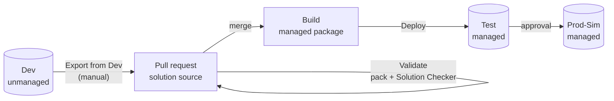

# Power Platform ALM with GitHub Actions

A free, end-to-end application lifecycle management (ALM) pipeline for Microsoft Power Platform,
built on GitHub Actions and Microsoft's official
[Power Platform Actions](https://github.com/microsoft/powerplatform-actions). It runs entirely on
free tiers: three Power Apps **developer environments** and a public GitHub repo.



## What it does

| Workflow | Trigger | Steps |
| --- | --- | --- |
| [Export from Dev](.github/workflows/export-from-dev.yml) | Manual | Stamps a version (`1.0.<run>.0`), exports managed + unmanaged, unpacks to `solutions/`, opens a PR, starts validation |
| [Validate](.github/workflows/validate.yml) | Pull request | Packs the solution from source and runs **Solution Checker**; results uploaded as an artifact |
| [Deploy](.github/workflows/deploy.yml) | Merge to `main` | Builds **one** managed package, imports it into Test, then into Prod-Sim after a required approval |

## Why it's built this way

- **Source control is the source of truth.** The solution lives in Git as unpacked XML/YAML, so every
  change is a reviewable diff, not an opaque `.zip`.
- **Managed downstream, unmanaged only in Dev.** Test and Prod-Sim only ever receive managed
  solutions, so nobody can edit them in place and drift away from what's in Git.
- **Build once, deploy many.** The exact artifact Test approved is what reaches Prod-Sim.
- **A human approves production.** The `production` GitHub environment has a required reviewer.
- **Service principal, not a person.** Deployments don't depend on anyone's account, password or MFA.
- **Per-environment settings in Git.** Connection references and environment variable values live in
  `deployment-settings/`, not in someone's head.

## Repository layout

```
.github/workflows/      Export, Validate, Deploy
solutions/<name>/       Unpacked solution source (created by the first export)
deployment-settings/    Optional per-environment settings: test.json, prod.json
docs/setup.md           One-time setup
```

## Getting started

See **[docs/setup.md](docs/setup.md)**: create a solution in Dev, create a service principal with one
`pac` command, add a few repo secrets and variables, and run **Export from Dev**.

## Free-tier notes

- Developer environments are free with the
  [Power Apps Developer Plan](https://learn.microsoft.com/en-us/power-platform/developer/plan) and are
  deleted after 90 days without use — keep them active, and remember the solution is safe in Git.
- GitHub Actions minutes are free for public repos.
- This uses developer environments as "Test" and "Prod-Sim" to practice the process; a real production
  environment needs proper licensing.
